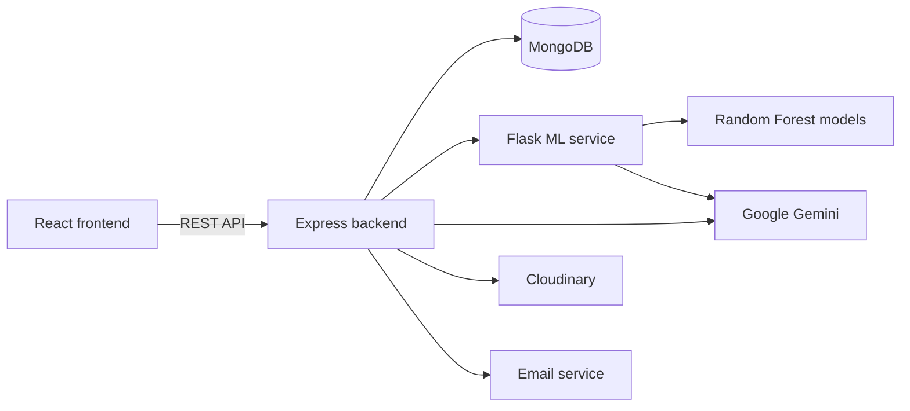

# MindBridge


A mental health support platform connecting patients and doctors, with self-assessment screening, appointment booking, mood journaling, and an AI chat assistant. MindBridge was developed as an academic team project, in the repository CBC_B-013.

> **Disclaimer:** MindBridge is an academic project. It does not provide medical diagnosis or treatment, and its screening models are trained on synthetic data. Always consult a qualified mental health professional for medical advice.

## Crisis Support (India)

If you or someone you know needs help now, please contact one of these helplines:

| Service | Number |
| --- | --- |
| iCall | 9152987821 |
| Vandrevala Foundation | 1860-2662-345 |
| NIMHANS | 080-46110007 |

## Overview

MindBridge offers separate experiences for patients and doctors. Patients can complete a guided assessment, track their mood, review their history, chat with an assistant, and book appointments. Doctors can view the patients who have booked with them. The platform runs as three services: a React frontend, a Node.js API, and a Python machine learning service.

## Key Features

| Feature | Description |
| --- | --- |
| Self-assessment | Multi-step screening for depression, anxiety, bipolar disorder, schizophrenia, and PTSD |
| Doctor booking | Search for doctors and book appointments |
| AI chat assistant | Supportive conversation powered by Google Gemini |
| Wellness journal | Daily mood entries with trend charts |
| Assessment history | Review of past assessment results over time |
| Resources library | Wellness material on CBT, meditation, and breathing |
| Doctor dashboard | List of booked patients with status indicators |
| Account management | Role-based access, email verification, password reset, and profile images |

## Technology Stack

| Layer | Technology |
| --- | --- |
| Frontend | React 19, Vite, Tailwind CSS, Zustand, Axios |
| Backend | Node.js, Express 5, Mongoose, JSON Web Tokens, bcryptjs |
| Database | MongoDB |
| Machine learning | Python, Flask, scikit-learn, joblib |
| AI | Google Gemini |
| Services | Cloudinary (images), Nodemailer (email) |

## Architecture and Workflow



## Project Structure

```text
CBC_B-013/
├── backend/src/
│   ├── controllers/      Request handlers
│   ├── middlewares/      Authentication, doctor access, and uploads
│   ├── models/           Mongoose schemas
│   ├── routes/           API routes
│   └── utils/            Email, Cloudinary, validation, and helpers
├── frontend/src/
│   ├── components/       Shared interface components
│   ├── pages/            Application pages
│   └── store/            Zustand state stores
├── python-apis/
│   ├── app.py            Flask API
│   ├── train.py          Model training
│   ├── predict.py        Model inference
│   ├── gemini_client.py  Gemini integration
│   └── models/           Trained models
├── .env.example
└── package.json
```

## Installation and Setup

### Prerequisites

- Node.js 18 or later
- Python 3.9 or later
- MongoDB, local or Atlas
- A Google Gemini API key
- A Cloudinary account and an email account for sending verification messages

### Clone and Install

```bash
git clone https://github.com/Partha-Shankar/CBC_B-013.git
cd CBC_B-013
npm install
npm install --prefix frontend
```

## Configuration

Copy `.env.example` to `.env` in the project root and provide your values. Also copy `python-apis/.env.example` to `python-apis/.env` and add your Gemini API key.

| Variable | Purpose |
| --- | --- |
| `PORT` | Backend port |
| `MONGODB_URI` | MongoDB connection string |
| `ACCESS_TOKEN_SECRET`, `ACCESS_TOKEN_EXPIRY` | Access token settings |
| `REFRESH_TOKEN_SECRET`, `REFRESH_TOKEN_EXPIRY` | Refresh token settings |
| `CLOUDINARY_CLOUD_NAME`, `CLOUDINARY_API_KEY`, `CLOUDINARY_API_SECRET` | Image hosting |
| `EMAIL_USER`, `EMAIL_PASS` | Outgoing email account |
| `CLIENT_URL` | Frontend URL used in email links |
| `NODE_ENV` | Runtime environment |
| `GEMINI_API_KEY` | Google Gemini API key |

## Usage

Run each service in its own terminal.

**Machine learning service**

```bash
cd python-apis
pip install -r requirements.txt
python train.py
python app.py
```

**Backend** (from the project root)

```bash
npm run dev
```

**Frontend**

```bash
cd frontend
npm run dev
```

| Service | Address |
| --- | --- |
| Frontend | `http://localhost:5173` |
| Backend | `http://localhost:8000` |
| Machine learning service | `http://localhost:5000` |

## Technical Implementation

### Screening Models

`train.py` trains one Random Forest classifier (100 estimators) for each of the five conditions. Training data is synthetic and generated from rules, so results illustrate the workflow and are not clinically validated. All models share eight input features:

```text
sleep_hours, mood_score, fatigue_level, stress_level,
social_interaction, restlessness_level, trauma_history, mood_swings
```

### Authentication

User accounts use Mongoose discriminators to separate patient and doctor records. Passwords are hashed with bcryptjs, and sessions use access and refresh tokens. Middleware restricts protected routes by login state and role.

## Contributors

This project was developed as a team effort. See the [commit history](https://github.com/Partha-Shankar/CBC_B-013/commits/main) for individual contributions.

## Future Scope

- Training on validated clinical datasets, with appropriate ethical review
- Automated tests across the three services
